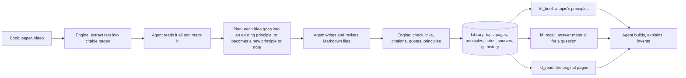

# Know Fu

<br>

<p align="center">
  
</p>

**Feed your AI books, papers and videos. Get back an expert you can build with.**

Know Fu is a local research library for an AI coding agent like Claude Code or Codex. You hand it a book, a paper or a video. The agent reads the whole thing and works out the principles behind it: what each one says, why it holds, where it breaks, and how far to trust it.

The next source doesn't get filed beside the first. It adds to what's already there, so the library gets sharper as it grows, not just bigger.

Later, when you're building something (a tool, a strategy, a course, an invention), the agent works from those principles like someone who has studied the field, and pulls up a number, a procedure or a worked case when a decision needs one.

The model's weights never change. What changes is what it can reach, and how well that's organized. The goal is the moment in *The Matrix* when Neo opens his eyes and says "I know kung fu".

[Set it up](plugin/docs/setup.md) · [How it works](plugin/docs/architecture.md) · [North star](docs/NORTH_STAR.md) · [Lineage](plugin/docs/lineage.md) · [Change log](CHANGELOG.md)

## The idea

Four things decide whether a library makes an AI better at a subject.

**Store what the model doesn't already know.** A frontier model knows what a compressor is and what overfitting means. What it lacks from a specialist source is the author's frame, the surprising claims, the numbers, the conditions where the usual advice breaks, and the worked cases. An ingest keeps those. The rest stays in the source, one search away.

**Organize by principle.** An expert sorts a problem by the principle behind it, and can work out what to do in a case no book covered. So every topic has a short front page that frames the subject and lists its principles in a line each. Each principle gets its own file. The front page is what the agent loads first.

**Hold each idea once, and add to it.** When a second source speaks to an idea the library already holds, it goes into that principle's file and sharpens it. When two sources disagree, both stay, with a note on what separates them. That's how a library compounds.

**Weigh what goes in.** A library that just repeats its sources makes a teacher's confident claim look the same as a tested result. So the agent judges each principle like a sharp colleague would: does the reason follow, what's the strongest objection, where is the support thin? Each principle carries that verdict, the kind of evidence behind it, and how many separate sources back it or dispute it.

## How it works



The library is a folder of plain Markdown. Open it in any editor and read it. Its history is in git, so every ingest is a commit you can inspect or undo.

```
library/
  INDEX.md
  knowledge/audio/mixing/TOPIC.md           the subject's frame and principles
  knowledge/audio/mixing/principles/*.md    one principle each: why, limits, merit, evidence
  knowledge/audio/mixing/notes/*.md         the detail behind them, cited to pages
  sources/<id>/source.md                    a map of the source, and what it changed
  sources/<id>/text.txt                     the extracted text, by page
  ideas/                                    candidate inventions, kept apart from evidence
```

The engine is small: TypeScript that Node runs directly, with no packages to install and nothing to build. It does the mechanical work (extraction, checking, search) and the agent does the reading and writing. Other tools are optional and picked up when they're there: Poppler for PDFs, Tesseract for scanned pages, pandoc for EPUB and DOCX, FFmpeg and a transcription API for recordings, yt-dlp for video links, and an embeddings endpoint for search by meaning.

A video with a chart or slides on screen is read as a video, not just a transcript. The engine finds each moment the screen changed and lays those out as filmstrips. The agent reads the transcript, spots where the words lean on the picture, and opens those frames at full size, cropping in when a detail matters.

## Using it

Know Fu runs when you invoke it: `/know-fu:know-fu` in Claude Code, `$know-fu` in Codex.

- **Ingest:** open a session in the library folder and say "ingest this book into audio/mixing".
- **Use:** in any project, invoke Know Fu and ask. The agent loads the topic's principles, then recalls specifics as it works.
- **Pin:** pin a topic to a project, and every session there starts with that topic's principles already loaded.

| Tool         | What it does                                                                                                  |
| ------------ | ------------------------------------------------------------------------------------------------------------- |
| `kf_status`  | Where the library is, what it holds, and what this session may do                                             |
| `kf_brief`   | What the library covers, or one topic's frame and principles                                                  |
| `kf_recall`  | For a question: the principles in play, the best notes, what disputes them, and where the sources speak to it |
| `kf_read`    | One principle, note or source page in full, including page images and video frames                            |
| `kf_connect` | How two ideas link                                                                                            |
| `kf_source`  | Add a book, paper, recording or video link                                                                    |
| `kf_check`   | Check the whole library and commit                                                                            |
| `kf_inbox`   | Save something worth keeping from any project to the library's inbox                                          |
| `kf_pin`     | Pin a topic to a project                                                                                      |

## Getting started

Clone the repository, open it in your coding agent and say:

> Read AGENTS.md and plugin/docs/setup.md, then set up Know Fu on this machine.

You need Node 22.18 or newer (24 recommended) and git. Everything else is optional, depending on what you feed it.

## Where it's at

Version 0.12, and still changing shape before 1.0. The [change log](CHANGELOG.md) has each step.

What's been shown so far is small and specific. Two agents, given only the skill, ingested two twenty-minute video lessons by different teachers into one library. The second lesson went into all three principles the first had produced, turned one guessed limit into a stated one, and added two principles of its own.

A third agent then compared that library with one built from the same videos under the previous layout, without knowing which was expected to win. It tried both on three cases and checked about twenty claims in each against the videos and exchange data. It found no wrong claim in the new library, one misreading repeated across four files in the old one, and called the new one "a clear win, not a landslide". The costs it named: more reading to answer a routine case, and principle files that grow with every source. That was one run per design.

Not yet shown: a whole book, more than two sources on one topic, and a long design session working from a topic page.

Versions up to 0.5 stored hundreds of small notes per book as database-style records. The first real book produced 425 notes that restated it at 63% of its length, with no page saying what its principles were. Version 0.6 rebuilt it around principles, and [the rebuild record](docs/REBUILD.md) has the reasoning.

Built and run on Windows 11.

## Working on the code

```sh
npm test
```

That runs every test with Node's own test runner. [AGENTS.md](AGENTS.md) has the rules for changing the engine and the guides, and [LESSONS.md](LESSONS.md) has what this project learned the hard way.

## Built from

TypeScript run by Node, `node:sqlite` with FTS5, and, where installed, Poppler, Tesseract, pandoc, FFmpeg and yt-dlp. The coding agent does all the reasoning; the engine never calls a language model. Embedding and transcription APIs are optional and billed separately.

The ideas come from Karpathy's LLM Wiki, Ars Contexta's Reweave, research on how experts organize knowledge, and [ste-bah](https://github.com/ste-bah)'s Memory Graph and Archon. The [lineage](plugin/docs/lineage.md) says what came from where.

## Boundaries

Ingesting a source isn't fine-tuning, and a library isn't expertise by itself: it's the footing for it. A link between two notes is a recorded connection, not proof.

The code is released under the [MIT licence](LICENSE). The README animation is third-party film imagery that the licence doesn't cover; see its [provenance note](assets/README.md). Your library, sources and credentials are never part of the repository.
