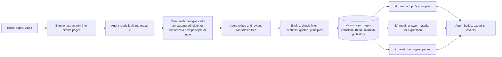

# Know Fu

<br>

<p align="center">
  
</p>

**Feed your AI books, papers and videos. Get back a collaborator that knows the subject.**

Know Fu is a local research library for an AI coding agent such as Claude Code or Codex. You hand it a source of specialist knowledge. The agent reads all of it and compiles what it learned into a library of plain Markdown: a front page for each subject that lists its principles, a file for each principle that says why it holds and how far to trust it, notes that hold the specifics, and the original text kept searchable underneath. The next source doesn't get filed beside the first. It revises what's already there, so the library gets sharper as it grows.

Later, when you're building something (a tool, a strategy, a course, an invention), the agent loads the subject's principles and works from them, fetching a number, a procedure or a worked case when a decision needs one.

The model's weights never change. What changes is what it can reach, and how well that's organized. The goal is the moment in *The Matrix* when Neo opens his eyes and says "I know kung fu".

[Set it up](plugin/docs/setup.md) · [How it works](plugin/docs/architecture.md) · [North star](docs/NORTH_STAR.md) · [Lineage](plugin/docs/lineage.md) · [Change log](CHANGELOG.md)

## The idea

Four things decide whether a library makes an AI better at a subject, and Know Fu is built around them.

**Store what the model doesn't already know.** A frontier model knows what a compressor is and what overfitting means. What it lacks from a specialist source is the author's frame, the claims that surprise, the numbers, the conditions where the usual advice breaks, and the worked cases. An ingest keeps those and leaves the rest in the source, which stays one search away. This is about what goes in, not about brevity: a note can run as long as its idea needs. What stays short is the page of principles.

**Organize by principle.** An expert sorts a problem by the principle that governs it, and can work out what to do in a case no book covered. So every topic has a front page, small enough to read whole, that frames the subject and lists its principles in a line each. Each principle has its own file: what it says, why it's true, where it breaks, what each source brings to it, and which notes rest on it. The front page is what the agent loads first.

**Hold each idea once, and add to it.** When a second source speaks to an idea the library holds, it goes into that principle's file as a new evidence entry, and the principle is sharpened in place. When two sources disagree, both stay, with a note of what separates them. A note is one piece of detail behind the principles (a mechanism, a method, a case, a reference table, a debate, a definition), cited to the page. That is how a library compounds.

**Weigh what goes in.** A library that repeats its sources hands over a teacher's confident assertion looking the same as a tested result. So as each principle is written, the agent judges its logic the way a sharp colleague would: does the reason follow, what is the strongest objection, where is the support thin. The principle carries that in a Merit line, names the kind of support it has (from a review of studies down to a bare assertion), and the front page shows how many separate sources hold it.

## How it works



The library is a folder of Markdown files, and the files are the library. You can open it in any editor and read it. Its history is in git, so every ingest is a commit you can inspect or undo.

```
library/
  INDEX.md
  knowledge/audio/mixing/TOPIC.md           the subject's frame and principles
  knowledge/audio/mixing/principles/*.md    one principle each: why, limits, merit, evidence
  knowledge/audio/mixing/notes/*.md         the detail behind them, cited to pages
  sources/<id>/source.md                    a map of the source, and what it changed
  sources/<id>/text.txt                     the extracted text, by page
  ideas/                                    candidate inventions, kept apart from evidence
```

The engine is small, with no packages to install and nothing to build. It is TypeScript that Node 24 runs directly, with Node's built-in SQLite for keyword search. Other tools are optional and found when they're needed: Poppler for PDFs, Tesseract for scanned pages, pandoc for EPUB and DOCX, FFmpeg and a transcription API for recordings, yt-dlp for video links, and an embeddings endpoint for search by meaning. The engine does the mechanical work: extraction, checking and search. The agent does the reading and the writing.

A video with a chart or slides on screen is read as a video, not as a transcript. When it's added, the engine finds each moment the screen changed and held still and lays those out as filmstrips. The agent reads the transcript, decides where the words lean on the picture, and opens those frames at full size, cropping when a detail matters. Frames that a claim rests on are kept with the source.

## Using it

Know Fu runs when you invoke it: `/know-fu:know-fu` in Claude Code, `$know-fu` in Codex.

- **Ingest:** open a session in the library folder and say "ingest this book into audio/mixing". The agent follows the [ingest guide](plugin/skills/know-fu/references/ingest.md).
- **Use:** in any project, invoke Know Fu and ask. The agent loads the topic's principles, then recalls specifics as it works.
- **Pin:** pin a topic to a project, and every session there starts with that topic's principles already in context.

| Tool | What it does |
|---|---|
| `kf_status` | The library's location and contents, and what this session may do |
| `kf_brief` | What the library covers, or one topic's frame and principles |
| `kf_recall` | For a question: the principles in play, the best notes in full, what disputes them, and where the sources speak to it |
| `kf_read` | One principle, note or source page in full, including page images and video frames |
| `kf_connect` | How two ideas link |
| `kf_source` | Register a book, paper, recording or video link and extract it; keep a video frame a claim rests on |
| `kf_check` | Check the whole library, bring derived parts in step, commit |
| `kf_inbox` | Save something worth keeping from any project to the library's inbox |
| `kf_pin` | Pin a topic to a project |

## Getting started

Clone the repository, open it in your coding agent and say:

> Read AGENTS.md and plugin/docs/setup.md, then set up Know Fu on this machine.

You need Node 22.18 or newer (24 recommended) and git. Poppler is needed for PDFs, Tesseract for scanned ones, pandoc for EPUB and DOCX, FFmpeg and a transcription API for audio and video, and yt-dlp to add a video by its link. There are no packages to install and nothing to build.

## Where it's at

Version 0.12, and still changing shape before 1.0. The [change log](CHANGELOG.md) has each step and the [north star](docs/NORTH_STAR.md) has the decisions behind them.

The current layout (a file per principle, each weighed for how well its logic holds) arrived in 0.12, after the owner read what earlier versions produced and asked for a library that stands behind what it holds. What has been shown for it is small and specific. Two agents, each given only the skill, ingested two twenty-minute video lessons by different teachers into one library, the second adding to what the first left. The second lesson went into all three principles the first had produced, turned one inferred limit into a stated one, and added two principles of its own. A third agent, not told which design was expected to win, compared that library with one built from the same videos under the previous layout. It tried both on three cases and checked about twenty claims in each against the videos and exchange data. It found no wrong claim in the new library (17 of 21 fully supported) and one misreading repeated across four files in the old one, found the weighing it checked fair, and would hand the new one to an agent to build from: "a clear win, not a landslide". The costs it named: about half again as much reading to answer one routine case, and principle files that grow with every source. That was one run per design.

Not yet shown: a whole book, more than two sources on one topic, and a long design session working from a topic page.

Video ingestion has run end to end on real lessons, with a live transcription provider. In a test on three lessons the filmstrips held 93% of the chart states worth seeing.

Version 0.6 was a rebuild. Versions up to 0.5 stored hundreds of small notes per book as JSON records with typed relationships between them, and the first real book ingest produced 425 notes that restated the book at 63% of its length, with no page that said what its principles were. [The rebuild record](docs/REBUILD.md) has the assessment, including what the rebuild dropped that later versions brought back. The 0.5 engine is kept on the `records-engine-0.5` branch.

It has been built and run on Windows 11.

## Working on the code

```sh
npm test
```

That runs every test with Node's own test runner. There is no build and no package to install; tests that need Poppler, FFmpeg or Tesseract skip where the tool is missing and say so. [AGENTS.md](AGENTS.md) has the rules for changing the engine and the guides, and [LESSONS.md](LESSONS.md) has what this project learned the hard way.

## Built from

TypeScript run by Node, `node:sqlite` with FTS5, and, where installed, Poppler, Tesseract, pandoc, FFmpeg and yt-dlp. The coding agent does all the reasoning; the engine never calls a language model. Embedding and transcription APIs are optional and billed separately.

The ideas come from Karpathy's LLM Wiki, Ars Contexta's Reweave, research on how experts organize knowledge, and [ste-bah](https://github.com/ste-bah)'s Memory Graph and Archon. The [lineage](plugin/docs/lineage.md) says what came from where.

## Boundaries

Ingesting a source isn't fine-tuning, and a library isn't expertise by itself: it is the footing for it. A link between two notes is a recorded connection, not proof. Research memory stays separate from operational or project memory, which belongs in a different tool.

The code is released under the [MIT licence](LICENSE). The README animation is third-party film imagery that the licence doesn't cover; see its [provenance note](assets/README.md). Your library, sources and credentials are never part of the repository.
