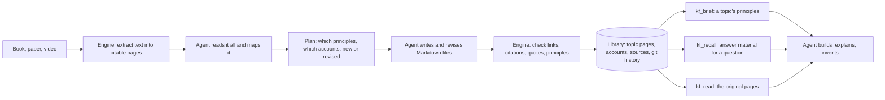

# Know Fu

<br>

<p align="center">
  
</p>

**Feed your AI books, papers and videos. Get back a collaborator that knows the subject.**

Know Fu is a local research library for an AI coding agent such as Claude Code or Codex. You hand it a source of specialist knowledge. The agent reads all of it and compiles what it learned into a library of plain Markdown: a page of principles for each subject, accounts that hold the specifics, and the original text kept searchable underneath. The next source doesn't get filed beside the first. It revises what's already there, so the library gets sharper as it grows.

Later, when you're building something (a tool, a strategy, a course, an invention), the agent loads the subject's principles and works from them, fetching a number, a procedure or a worked case when a decision needs one.

The model's weights never change. What changes is what it can reach, and how well that's organized. The goal is the moment in *The Matrix* when Neo opens his eyes and says "I know kung fu".

[Set it up](plugin/docs/setup.md) · [How it works](plugin/docs/architecture.md) · [North star](docs/NORTH_STAR.md) · [Lineage](plugin/docs/lineage.md) · [Change log](CHANGELOG.md)

## The idea

Three things decide whether a library makes an AI better at a subject, and Know Fu is built around them.

**Store what the model doesn't already know.** A frontier model knows what a compressor is and what overfitting means. What it lacks from a specialist source is the author's frame, the claims that surprise, the numbers, the conditions where the usual advice breaks, and the worked cases. An ingest keeps those and leaves the rest in the source, which stays one search away. A first book on a subject usually compiles to a tenth or a fifth of its length.

**Organize by principle.** An expert sorts a problem by the principle that governs it, and can work out what to do in a case no book covered. So every topic has one page, small enough to read whole, that states the subject's principles: what each one says, why it's true, where it breaks, and which accounts are cases of it. That page is what the agent loads first.

**Hold each idea once, and revise it.** An account is one idea (a mechanism, a method, a case, a reference table, a debate), cited to the page. When a second source speaks to the same idea, the account is revised and both sources are listed on it. When two sources disagree, both stay, with an account of what separates them. That is how a library compounds.

## How it works



The library is a folder of Markdown files, and the files are the library. You can open it in any editor and read it. Its history is in git, so every ingest is a commit you can inspect or undo.

```
library/
  INDEX.md
  knowledge/audio/mixing/TOPIC.md           the subject's frame and principles
  knowledge/audio/mixing/accounts/*.md      one idea each, cited to pages
  sources/<id>/source.md                    a map of the source, and what it changed
  sources/<id>/text.txt                     the extracted text, by page
  ideas/                                    candidate inventions, kept apart from evidence
```

The engine is small and has nothing to install. It is TypeScript that Node 24 runs directly, with Node's built-in SQLite for search and Poppler for PDFs. It does the mechanical work: extraction, checking and search. The agent does the reading and the writing.

## Using it

Know Fu runs when you invoke it: `/know-fu:know-fu` in Claude Code, `$know-fu` in Codex.

- **Ingest:** open a session in the library folder and say "ingest this book into audio/mixing". The agent follows the [ingest guide](plugin/skills/know-fu/references/ingest.md).
- **Use:** in any project, invoke Know Fu and ask. The agent loads the topic's principles, then recalls specifics as it works.
- **Pin:** pin a topic to a project, and every session there starts with that topic's principles already in context.

| Tool | What it does |
|---|---|
| `kf_status` | The library's location and contents, and what this session may do |
| `kf_brief` | What the library covers, or one topic's frame and principles |
| `kf_recall` | For a question: the principles in play, the best accounts in full, what disputes them, and where the sources speak to it |
| `kf_read` | One account, principle or source page in full, including page images and video frames |
| `kf_connect` | How two ideas link |
| `kf_source` | Register a source and extract its text |
| `kf_check` | Check the whole library, bring derived parts in step, commit |
| `kf_note` | Save something worth keeping from any project to the library's inbox |
| `kf_pin` | Pin a topic to a project |

## Getting started

Clone the repository, open it in your coding agent and say:

> Read AGENTS.md and plugin/docs/setup.md, then set up Know Fu on this machine.

You need Node 22.18 or newer (24 recommended) and git. Poppler is needed for PDFs, pandoc for EPUB and DOCX, FFmpeg and a transcription API for audio and video. There are no packages to install and nothing to build.

## Where it's at

Version 0.6 is a rebuild. Versions up to 0.5 stored hundreds of small notes per book as JSON records with typed relationship records between them. The first real book ingest showed what that produced: 425 notes that restated the book at 63% of its length, with no page that said what the book's principles were. [The rebuild record](docs/REBUILD.md) has the assessment and the reasoning, and the 0.5 engine is kept on the `records-engine-0.5` branch.

What has been shown so far is small and specific. An agent given only the skill ingested three chapters of a book (70 pages) in 11 minutes and passed the checker; a separate fidelity check found every number right, and found a handful of places where the compiler's inference read as the author's view, which the guides now guard against. In a blind comparison on nine tasks, answers from the 0.6 library and from the 0.5 library scored level (165 of 180 each), with the 0.6 side using 29% fewer tokens and a compiled layer a fraction of the size. Not yet shown: a whole book, a second source revising the first, and a long design session working from a principles page. [The rebuild record](docs/REBUILD.md#acceptance) has the details and the limits.

It has been built and run on Windows 11. Audio and video transcription is written and tested against a stand-in server, and hasn't been run against a live provider.

## Working on the code

```sh
npm test
```

That runs every test with Node's own test runner. There is no build and no dependency to install. [AGENTS.md](AGENTS.md) has the rules for changing the engine and the guides, and [LESSONS.md](LESSONS.md) has what this project learned the hard way.

## Built from

TypeScript run by Node, `node:sqlite` with FTS5, Poppler, pandoc and FFmpeg. The coding agent does all the reasoning; the engine never calls a model. Transcription APIs are optional and billed separately.

The ideas come from Karpathy's LLM Wiki, Ars Contexta's Reweave, research on how experts organize knowledge, and [ste-bah](https://github.com/ste-bah)'s Memory Graph and Archon. The [lineage](plugin/docs/lineage.md) says what came from where.

## Boundaries

Ingesting a source isn't fine-tuning, and a library isn't expertise by itself: it is the footing for it. A link between two accounts is a recorded connection, not proof. Research memory stays separate from operational or project memory, which belongs in a different tool.

The code is released under the [MIT licence](LICENSE). The README animation is third-party film imagery that the licence doesn't cover; see its [provenance note](assets/README.md). Your library, sources and credentials are never part of the repository.
